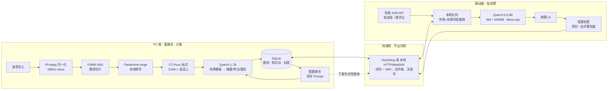

# Offline-Tutor


> 纯离线端侧 AI 学习系统：录音 → 转写 → 出题 → 刷题 → 错题回流 → 更准的题。
> **我只出图纸，不搬砖。**

[致开发者](#致开发者) · [为什么](#为什么还要造一个轮子) · [架构](#架构) · [局限](#坦诚的局限) · [路线图](#接力路线图) · [协议](#协议)

---

## 致开发者

这个 Idea 是我想的，但这个项目不是我做的。

学业繁忙，没有时间写一行代码。本仓库只有架构、选型和踩坑预判，**没有可用代码**。
我不会回复 Issue，不会 Review PR，不会发版，也不承诺这个仓库会变好。

- Fork、改、商用、闭源、拿去交作业 —— 不用问我，也不需要授权。
- 做成了不用署名我；做砸了别来找我。
- 真有人跑通了，开个 Issue 留个链接，我点个 Star。

就这些。

---

## 为什么还要造一个轮子

现成方案的硬伤只有两个，但都很致命：

| 硬伤 | 具体表现 |
|---|---|
| **隐私** | 医法问诊、企业内训、1:1 面谈的录音，合规上根本出不了内网。上传即事故。 |
| **深度** | 云端模型转写完给你一段"总结"，看着热闹，但对你的薄弱点一无所知。下次考还是错。 |

要的东西很朴素：**数据一步都不出局域网**，且**越用越懂你错在哪**。

---

## 架构

三段式：**PC 重建设 · 手机轻消费 · 局域网自动同步**。

PC 是大脑 —— 算力、模型、原始数据、题池都在这里。
手机是终端 —— 只负责"刷"和"打标"，不做训练，不做长录音转写。

> 同步层单独拆了一份：为什么选 Syncthing、怎么把 11 秒压到 2 秒、冲突怎么治 →
> **[docs/sync.md](docs/sync.md)**



### 数据流（文字版，给不想看图的）

**建设期（PC）**
1. 录音进 `inbox/`，FFmpeg 归一化成 16kHz 单声道。
2. FSMN-VAD 按静音切段（不是按固定时长切，避免切断句子）。
3. Paraformer-large 逐段转写 → 拼回带时间戳的全文。
4. 按考试类型选模板（如"法考·刑法""企业内训·合规"），Qwen3-1.7B 产出：分段摘要、考点、题干、选项、解析。
5. 落库为 `item`，带 `source_span`（转录稿字符区间），保证任何一道题都能回溯到原话。

**消费期（手机）**
6. 增量题包经局域网同步到手机（同 WiFi，Syncthing 或本地 HTTP）。
7. 飞行模式下直接刷题，答案、解析都在本地。
8. 每次作答写一条 `attempt`：选了什么、对不对、耗时、自评置信度、错误类型标签。

**回流期（飞轮）**
9. `attempt` 回传 PC，按知识点聚合出掌握度与高频错误类型。
10. 用聚合结果**改写生成 Prompt**（不是重训模型），针对薄弱点再造变体题。
11. 变体题再次下发。回到第 7 步。

### 数据飞轮到底"飞"在哪

诚实说：不是"训练飞轮"，是**提示词飞轮**。

```
错题标签 ──聚合──> 薄弱点画像 ──拼装──> 新 Prompt ──生成──> 变体题
   ▲                                                        │
   └────────────────── 再作答、再打标 ◀────────────────────┘
```

真正在学习的是**你的标注**，不是模型权重。模型权重一动不动。
如果哪天有人愿意做 LoRA 微调，那是 P4 的事，不是这个 Idea 的前提。

---

## 选型与理由

| 环节 | 选型 | 为什么 | 代价 |
|---|---|---|---|
| 转写 | **Paraformer-large**（FunASR） | 中文原生、非自回归，CPU 上比同精度 Whisper 快一个量级；配套 VAD、标点、说话人齐全 | 多语言差；模型栈约 1.5GB |
| 长音频 | **FSMN-VAD + 分段归并** | 上下文物理上限，绕不过去 | 跨段指代会丢，需二次归并 |
| 出题 | **Qwen3-1.7B**（4bit，约 1.2GB） | PC 上能跑、中文指令跟随够用、可完全离线 | 干扰项质量是硬伤，见下 |
| 刷题 | **Qwen3.5-0.8B**（4bit，约 500MB） | 手机上唯一现实的尺寸 | 掉点明显，只做判分/解析，不做出题主力 |
| 推理 | llama.cpp（PC 与手机共用 GGUF） | 一套量化格式两端跑，省事 | 手机端要自己编 JNI |
| 存储 | SQLite | 单文件、可同步、可回溯 | 无 |
| 同步 | Syncthing / 本地 HTTP | 零配置、纯局域网、无账号 | 同 WiFi 才行；Android 后台会被杀 |

> 关于 **Qwen3.5-0.8B**：这是写这份 RFC 时假定的目标尺寸。若该型号未发布或量化质量不达标，等价替换为同期 0.6B~1B 级别的 Instruct 模型即可，架构不变。**不要为此改架构。**

---

## 关键设计决策（省得你重新踩）

1. **不做"全手机"方案。** 手机端跑完整转写+出题，必然烫手且慢。分工是硬约束，不是优化。
2. **不让小模型自由发挥。** 模板里把"考什么、几道题、干扰项怎么造、输出什么 JSON"全部写死，模型只填空。自由度 = 幻觉空间。
3. **后台批量，不实时。** 手机端推理只在"充电 + 息屏"时跑队列。用户看到的是"题已经准备好了"，不是进度条。
4. **每道题必须能回溯原话。** 存 `source_span`。转写错一个字，题目就可能整道废掉，没有回溯就无从排查。
5. **同步只同步增量。** 题包按 `updated_at` 做差量，别整库推。

---

## 坦诚的局限

这些不是"待优化"，是**这套架构的下限**。接手前请先接受它们。

### 1. 小模型的干扰项"一眼假"

1.7B 造干扰项的通病：要么明显荒谬，要么把正确答案换个说法又抄一遍，要么四个选项长度严重失衡。

- 靠强 Prompt 模板约束能把可用率压到 **约 72%**（人工抽检，小样本，**不是 benchmark**）。
- 剩下 28% 必须人工改，或者直接丢弃。**这是常态，不是 bug。**
- 缓解方向：给"反例库"（把上轮被判假的一眼假干扰项塞回 Prompt）、限定干扰项生成策略枚举（同类概念替换 / 条件缺失 / 因果倒置 / 数值偏移）、用规则做长度与词性均衡。
- 别指望换个大模型就解决 —— 换大了手机就装不下，这是死结。

### 2. 超过 30 分钟的录音必然超上下文

- 1.7B 的有效上下文远小于标称值，30 分钟中文转录稿轻松上万 token 就崩。
- 必须 VAD 切段 → 分段总结 → 二次归并。**没有第二条路。**
- 切段的代价：跨段指代丢失、结论被拆散、同一考点在多段重复出现。归并层要自己写去重。
- 60 分钟以上的会议，分段质量直接决定最终题池质量。这一步没有银弹。

### 3. 手机端仍然会热，且门槛极高

- 量化到 500MB 也只是"能跑"，不是"好用"。持续推理依旧发热、掉电、首 token 慢。
- 后台批处理把发热摊薄了，但没有消除。夏天该烫还是烫。
- **真正的门槛不在技术，在部署。** 普通用户不会配 Python 环境、不会下模型权重、不会编 llama.cpp、不会开 Syncthing。这套东西目前只服务"愿意折腾的人"。
- 想做成产品，得把上面四件事全部封装掉 —— 那是另一个工程量级的工作。

### 4. 其它，一并交代

- **没有评测集。** 72% 是拍脑袋抽检出来的，你要做就得自己做标注集。
- **没有微调。** 全程提示词工程 + 规则，模型权重不变，"飞轮"转得比听起来慢。
- **同步会掉链子。** 同 WiFi、端口、防火墙、Android 后台保活，每一项都能卡住用户。
- **转写错误会污染题池。** 专业术语（法条、药名、内部黑话）Paraformer 会错，错一个词，整道题的答案可能就是错的。需要热词表 + 人工抽检。

---

## 非目标

明确不做的，别在 Issue 里问：

- ❌ 多用户 SaaS、账号体系、云端备份
- ❌ 手机端训练 / 微调
- ❌ 实时字幕
- ❌ 追赶 SOTA 的转写精度
- ❌ 给完全不懂技术的人开箱即用（那是产品问题，不是这个 RFC 的问题）

---

## 接力路线图

给接盘者的分阶段建议。**每一阶段都有验收标准，别跳步。**

### P0 · 跑通 PC 脚本（约 2 周）

一条命令：`audio/*.wav` → `out/transcript.md` + `out/questions.json`。

- [ ] FFmpeg 归一化 + VAD 切段
- [ ] FunASR 加载 Paraformer-large，输出带时间戳的分段文本
- [ ] Qwen3-1.7B（llama.cpp，GGUF）按模板出题，JSON 可解析
- [ ] **验收：3 个 30 分钟真实录音，端到端零联网跑通，JSON 100% 可解析**

### P1 · 题池与错题闭环（PC 单机，约 2 周）

- [ ] 建库（schema 见下）
- [ ] 手动录入作答 → 聚合掌握度 → 改写 Prompt → 生成变体
- [ ] **验收：同一薄弱点能稳定产出 N 个变体题，人工判定可用率 ≥ 70%**

### P2 · 移动端 App（先 Android，约 4~6 周）

只做三件事：读题包、刷题、写标签。不做转写、不做生成。

- [ ] 题包增量同步（Syncthing 或最小 HTTP 服务，详见 [docs/sync.md](docs/sync.md)）
- [ ] llama.cpp JNI 封装，加载 0.8B 4bit
- [ ] 后台任务队列（WorkManager，充电+息屏触发）
- [ ] **验收：飞行模式下连续刷 30 题不崩、不闪退**

### P3 · 飞轮闭合（约 2~4 周）

- [ ] attempt 回传、聚合、Prompt 自动改写、变体自动下发，全自动无人值守
- [ ] **验收：A/B 对比 —— 有飞轮 vs 无飞轮，同一知识点的错题率下降可量化**

### P4 · 有人有闲再说

- [ ] LoRA 微调（需要标注量和显卡，慎重）
- [ ] iOS
- [ ] PC 侧 Web 复习界面
- [ ] 热词表 / 术语词典

---

## 附录：最小数据模型

够用就好，别一开始就设计大系统。

```sql
CREATE TABLE item (
  id           TEXT PRIMARY KEY,
  knowledge_id TEXT NOT NULL,   -- 知识点
  stem         TEXT NOT NULL,
  options_json TEXT NOT NULL,   -- ["A ...", "B ...", ...]
  answer       TEXT NOT NULL,   -- "B"
  rationale    TEXT,            -- 解析
  source_span  TEXT,            -- 转录稿字符区间，可回溯原话
  variant_of   TEXT,            -- 由哪道题变异而来
  model        TEXT,            -- 生成模型 + 版本
  prompt_ver   TEXT,            -- 便于回滚 Prompt
  created_at   INTEGER
);

CREATE TABLE attempt (
  id         TEXT PRIMARY KEY,
  item_id    TEXT REFERENCES item(id),
  device     TEXT,              -- pc / android / ios
  chosen     TEXT,
  correct    INTEGER,
  latency_ms INTEGER,
  confidence INTEGER,           -- 1..5 自评
  error_tag  TEXT,              -- 概念混淆 / 计算 / 审题 / 记忆
  created_at INTEGER
);

CREATE TABLE mastery (          -- 派生表，随时可重算
  knowledge_id TEXT PRIMARY KEY,
  attempts     INTEGER,
  correct      INTEGER,
  last_seen    INTEGER,
  weight       REAL             -- 决定下轮出题占比
);
```

## 附录：Prompt 契约

小模型靠约束活着。模板骨架照抄即可，自由度全部锁死。

```
你是一位{考试名称}命题人。仅使用【资料】中的内容命题，不得引入外部知识。

【资料】
{segment_text}

【薄弱点】
{top_error_tags}          ← 由 attempt 表聚合得出

【要求】
1. 生成 {n} 道单选题，每题必须命中【薄弱点】中的至少一项；
2. 4 个选项。干扰项必须是"看起来对的错误"，策略限定为：
   同类概念替换 / 条件缺失 / 因果倒置 / 数值偏移；
3. 禁止"以上都对/都不对"；禁止题干自相矛盾；禁止选项长度明显失衡；
4. 只输出 JSON，不要解释，不要 Markdown 代码块。

【反例｜以下干扰项已被判定为"一眼假"，不要模仿】
{bad_distractors}
```

---

## 协议

- 代码：**WTFPL** —— 你他妈的想干嘛就干嘛。
- 文档与本架构描述：**CC0 1.0** —— 放弃所有权利，无需署名。

商用、闭源、改名、去掉这段声明，都随意。
**随便用，别来烦我。**

---

<p align="center">
  <sub>Offline-Tutor · 一个没人维护的 Idea · 图纸给你了，砖自己搬</sub>
</p>
