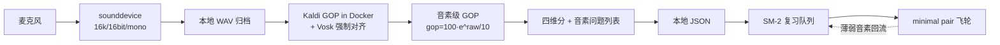
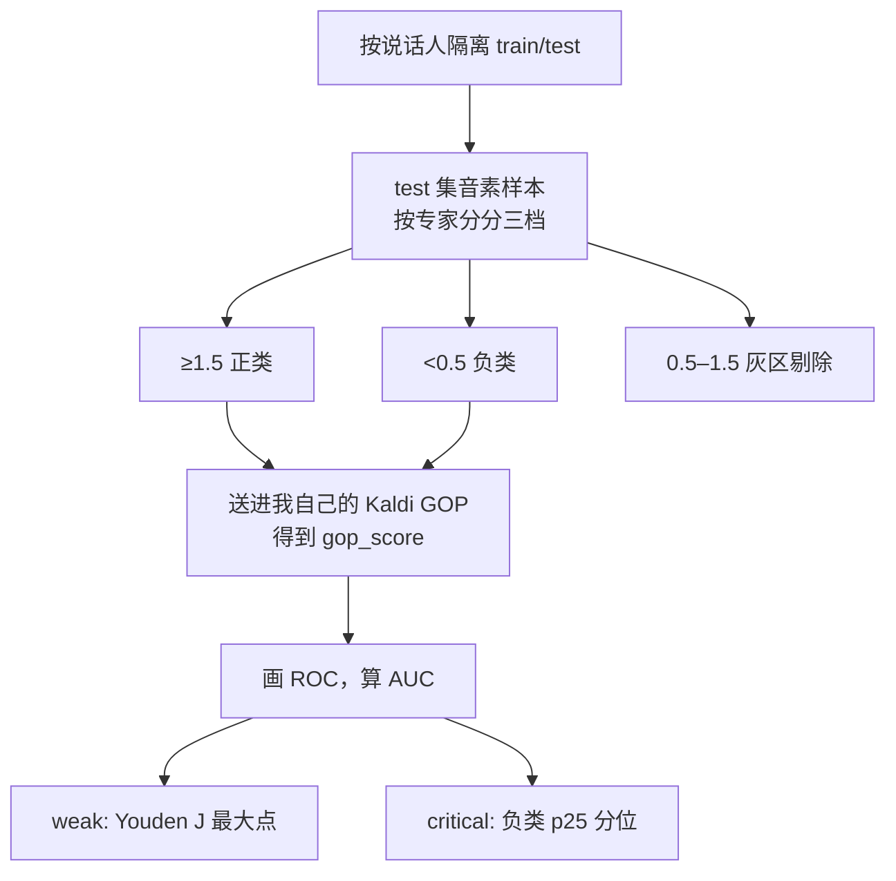
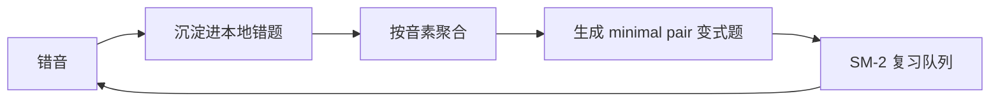

# 我花了好久才想明白：给英语发音打分，"多差算差"比打分本身难多了

> 我做过一个 100% 本地离线的音素级英语朗读测评工具。这篇文章聊聊我踩过的坑，尤其是最后那个卡了我很久的阈值问题。

说实话，刚动手的时候我以为最难的是打分。后来发现完全不是——打分公式是现成的，真正让我卡住的，是怎么回答一句特别朴素的话：**"读成什么样算错？"**

## 我为什么非要抠到音素

市面上那些发音评分，基本都是单词级的 good / bad / fair。我觉得这东西糊弄不了人。用户真正想知道的是"我到底哪个音发错了"，是 /ɪ/ 和 /iː/、/θ/ 和 /s/ 这些让中国人头疼的对立音。

所以这项目从第一天起我就只认一个粒度：音素。

定位我也定得挺死：买断制、一次性授权、自己写着玩、不指望靠它赚钱。用户原声 100% 不出我这台机器。这几条听着简单，其实把后面的路给框死了——整条链路必须纯本地，也直接埋下了我最大的那个坑。

## 我的工具长这样

技术栈真没什么花活：PySide6 做壳，sounddevice 录音，Kaldi GOP 跑在 Docker 里配 Vosk 做强制对齐，服务只在局域网里跑，存储就是纯 JSON。

有几条线我从头到尾没松过：原声不上任何公有云（讯飞、腾讯、阿里、百度这些 API 我直接一票否决）；Kaldi 只在 Docker 里，死活不在 Windows 原生编译；不拿合成数据、假数据兜底，哪一步卡住 30 秒我就停下来看。

## 真正卡住我的，是那两条线

评分公式现成的，我很快跑通了。但接着就撞墙了：**weak（弱）和 critical（临界）这两条线，到底定多少？**

一开始我用的是占位值，70 和 55。但占位值说白了不叫标定，飞轮里"哪些音算错"那一环也一直空转。我得找个真值来源。

### 我试了三条路，全堵死了

最直觉的想法是"自己读、自己标"。结果走不通——做这项目的人（也就是我）分不清长短音。读不准，给不了靠谱的"标准音"；听辨不了，给不了对/错 label。

我不死心，又试了几条替代，一条比一条坑：

| 我试过的 | 为什么放弃 |
|---|---|
| 云 TTS 合成标准音 | 上传的是文本，倒不破"原声"红线，但破了我自己定的"纯离线"，而且英语音素级标准度我信不过 |
| 合成错读样本 | 合成音的"错"是算法造出来的，不是真人嘴里真发出来的错，GOP 对它的响应跟真人根本不一样 |
| 同一段音频换文本伪造 bad | 声学上压根没变，纯属自欺欺人 |

**这一圈下来，我最大的收获就一句话：合成样本不能拿来定阈值。** 真值必须来自真人发音 + 真人专家的标注。任何合成捷径，标出来的线到真实用户身上就得失效。方向错了，后面越使劲越偏。

### 后来我撞见一份简直量身定做的数据

转机是 OpenSLR 上的 **speechocean762**（SLR101）。我看到它的时候有点激动：

- 5000 句英语，说话人全是**母语普通话的非母语学习者**——这不就是我目标用户的画像吗；
- **5 位专家独立打分**，有音素级分数（0–2 浮点，5 个人取均值），还有句级四维（0–10）；
- 授权 **CC BY 4.0，可以商用**，义务只是署个名。

它一下把我两个死结都解开了：真人发音（不碰合成红线）+ 现成的专家 label（不用我有耳朵）。而且是多个人录的，顺手把我之前担心的"单人声纹垄断"也给治了——同一个人的声音标出来的线，换个人就不好使。

### 89 和 79 是这么定出来的

中间那档语义太模糊，我干脆全扔了，不给后面留噪声。把真人的音喂进我自己的 GOP，拿到分数，再看这分数区分对错的能力——**AUC 0.855**，方向是靠谱的。

- **weak = 89**：我取的是 Youden J（TPR−FPR）最大的那个点，J=0.579（TPR 0.746 / FPR 0.167）。还有个备选是 FPR≈0.1 的点，但它把 TPR 压到 0.615，等于把 38% 本来读对的音判成弱的，我觉得这代价太大，弃了。
- **critical = 79**：我取负类的 p25 分位（78.8），保守点，只抓最差的那 25% 错音，符合我"宁可漏报、别冤枉人"的想法。

这两条线都是真值和 ROC 推出来的，不是我拍脑袋取的分位。逐音素 AUC 我也拉出来了：/l/ .934、/iː/ .897、/ɪ/ .887、/w/ .872、/s/ .867、/r/ .809、/v/ .784。

### 有个问题我选择了说出来

句子级四维跟专家分对标的时候，没过：

| 维度 | Pearson | 问题 |
|---|---|---|
| accuracy | +0.05 | 方向对，但极弱，值域也没法比 |
| fluency | −0.47 | 方向反了 |
| prosody | +0.05 | 92% 样本全顶在 100 分，所谓排序相关就是一堆并列造成的假象 |
| completeness | — | forced 模式下恒等于 100，没法比 |

结论挺直接的：**音素级 GOP 能标定，句子级四维目前对标不了专家分**。所以这一轮我只落地音素级，四维算法没动、另说。我把这事写进报告里了——比起假装四维也达标，我觉得这样诚实点。

## 我让错误自己滚起来

打分不是终点，让错误推着复习走才有意思：

SM-2 我用来做间隔重复（easiness / interval / repetitions / due_date / lapses，三档评分决定下次什么时候到期）；minimal pair 我内置了 12 组对立词，错哪个音就推对应的对立词变式题。飞轮里"哪些音算错"那个阈值原来一直是占位的 70，标定完接到了 weak=89，飞轮才从空转变成真值驱动。我还加了每个音素最多 6 张卡的上限，防它爆掉。

## 我这几条土规矩

这项目我是用"主决策 + 执行层"的分工推的：我这边只做判断、看产出、给下一步目标，另一个 AI 负责动手写代码。有几条规矩我反复验证过有用：

1. **先摸底，先减法后加法**——砍掉没用的方案，比堆功能重要多了；
2. **执行层不许自报通过**——只交证据，我自己独立验收；
3. **安全的东西不下线**——校验、报错处理、可访问性，绝不因为赶工就砍；
4. **同一个错犯两次才立规矩**——别拿一次意外固化成流程；
5. **错误信息别藏着**——标定冲突、四维失败、样本不够，全写进报告。

这套方法最值钱的地方，就在"合成样本不能标定"这种认知修正上。

## 还没解决的问题

- 标定样本只有 47 句（本来计划 110），偏负类，/θ/ 一个样本都没有。AUC 方向可信，但置信区间偏宽，我想扩到 200 句以上再复核一次；
- 对立词覆盖 14/24，缺 chip/cheap、vine/wine、vip/wip 三组，儿童占一半也没分龄验证；
- weak=89 会把不少音素算成"低于阈值"（抽样偏负类闹的），我用问题数截断 + 主要展示 critical 来控；
- 逐音素正文标红的位置映射还没做；句子级四维暂时也跟专家分对不上。

这些我都如实记着，不编达标数据骗自己。
---

**数据和署名**：speechocean762 — Zhang et al., *speechocean762: An Open-source Non-native English Speech Corpus for Pronunciation Assessment*, Interspeech 2021. CC BY 4.0 授权。标定数据不随软件分发，只用来定阈值。
